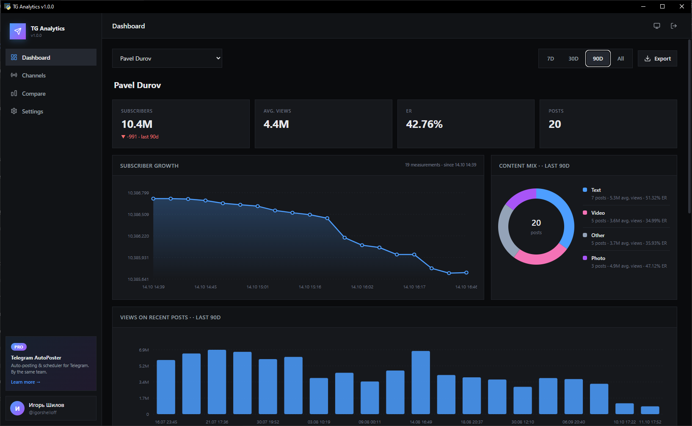
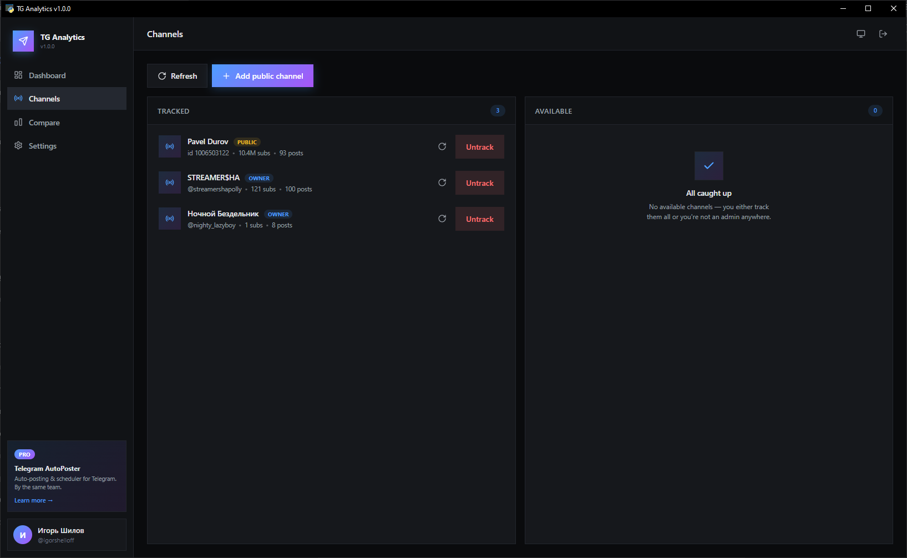
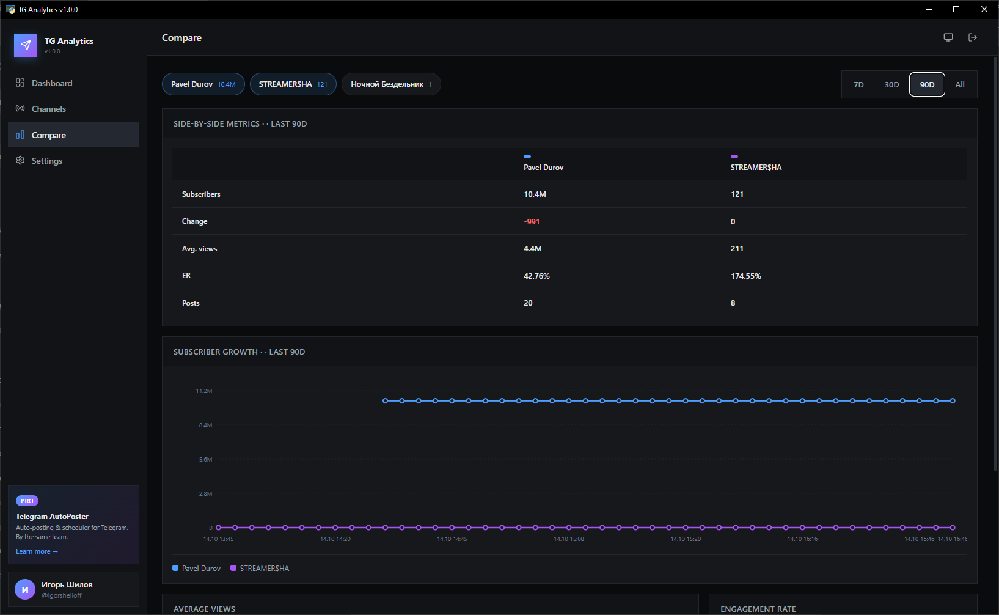
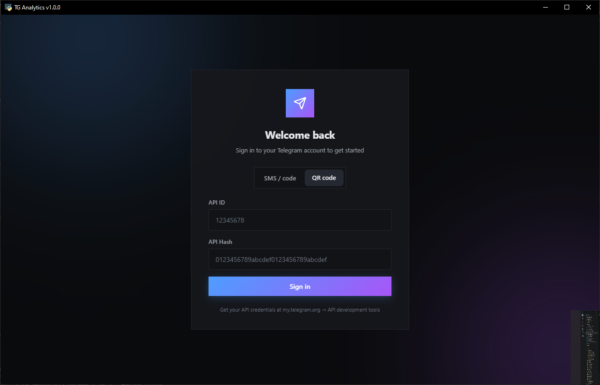

# TG Analytics

[](https://python.org)
[](https://pywebview.flowrl.com)
[](https://docs.telethon.dev)
[](LICENSE)
[]()
[](https://github.com/Igor-Shelloff/tg-analytics/releases/latest)

**A modern open-source desktop app for Telegram channel analytics.** Track subscriber growth, engagement rates, top posts, best posting times and content mix — for your own channels and any public channel. Everything runs **locally on your machine**.

[Features](#-features) • [Screenshots](#-screenshots) • [Installation](#-installation) • [Usage](#-usage) • [FAQ](#-faq) • [Advanced](#-advanced-features) • [Support](#-support-the-project)

---

## About

**TG Analytics** is a free, open-source desktop application that helps Telegram channel owners, marketers and content creators understand their audience.

Unlike SaaS analytics platforms (TGStat, Telemetr), TG Analytics:

- **Stores everything locally** — your data never leaves your computer
- **Analyzes any public channel** — track competitors without admin rights
- **Works offline** — after the first sync, all charts and reports render from the local database
- **Is completely free** — no subscriptions, no limits, no ads

Perfect for:

- **Channel owners** — monitor growth, engagement, and find the best time to post
- **Content teams** — understand which content types perform best
- **Marketers** — research competitors and benchmark against industry peers
- **Agencies** — generate beautiful PDF reports for clients

The app uses the official [Telegram API](https://my.telegram.org/) through Telethon. No third-party servers see your data.

---

## ✨ Features

### 📊 Analytics
- **Subscriber growth** — daily/hourly chart with automatic granularity (raw → hourly → daily)
- **Engagement rate (ER)** — average views ÷ subscribers, per period and per content type
- **Best posting time** — 7×24 heatmap of average views by weekday and hour
- **Top posts** — ranking by views, reactions and forwards
- **Content mix** — text / photo / video / documents with per-type ER

### 📡 Channel tracking
- **Your own channels** — auto-detects channels where you're an admin or owner
- **Any public channel** — add by `@username`, `t.me/...` link or numeric ID
- **Background collection** — configurable interval (15 min – 6 hours or manual)
- **Import history** — up to 100 latest posts per channel on first sync

### 🔍 Comparison
- **Side-by-side metrics** — compare up to 6 channels on one screen
- **Multi-line growth chart** — one line per channel with shared timeline
- **Average views & ER bars** — instant visual comparison

### 📤 Export
- **PDF report** — beautifully typeset A4 report with charts and branding
- **JSON** — full structured dump (snapshots + posts + metrics)
- **CSV** — raw post data, Excel-friendly (UTF-8-BOM, `;` delimiter)

### 🎨 Interface
- **Modern dark / light / system theme** — follows OS by default
- **English + Русский** — instantly switchable
- **Smooth animations, zero flicker** — built on HTML/CSS/JS via pywebview
- **Responsive layout** — sidebar fixed, only content scrolls

### 🔒 Privacy
- **100% local** — SQLite database in `~/.tg_analytics/`
- **No telemetry** — the app never phones home
- **Open source** — audit every line

---

## 📸 Screenshots

Dashboard | Channels
---|---
 | 

Compare | Login
---|---
 | 

---

## 🚀 Installation

### Option 1: Download prebuilt executable _(recommended)_

Grab the latest release for your OS from the [Releases page](https://github.com/Igor-Shelloff/tg-analytics/releases/latest):

- **Windows** — `TGAnalytics-Windows.exe`
- **Linux** — `TGAnalytics-Linux` (make it executable with `chmod +x`)
- **macOS** — `TGAnalytics-macOS.zip` (unzip and drag `TG Analytics.app` into Applications)

> ⚠️ **macOS:** The app is not code-signed. On first launch macOS may block it.
> To allow it, open **Terminal** and run:
>
> ```bash
> xattr -cr "/Applications/TG Analytics.app"
> ```
>
> Alternatively: right-click the app → **Open** → **Open** in the dialog.

No Python installation required. Just run it.

### Option 2: Run from source

**Requirements:** Python 3.10 or newer.

```bash
git clone https://github.com/Igor-Shelloff/tg-analytics.git
cd tg-analytics
python -m venv venv

# Windows
venv\Scripts\activate

# Linux / macOS
source venv/bin/activate

pip install -r requirements.txt
python main.py
```

---

## 📖 Usage

### 1. Get your Telegram API credentials

1. Go to [my.telegram.org](https://my.telegram.org)
2. Log in with your phone number
3. Open **API Development Tools** and create a new app
4. Copy your **API ID** and **API Hash**

### 2. Sign in

Open the app, paste your **API ID**, **API Hash** and phone number — or scan the QR code with the Telegram mobile app.

### 3. Track channels

- **Your own channels** — the **Channels** tab automatically lists every channel where you're an admin
- **Any public channel** — click **Add public channel**, paste a `@username` or `t.me/...` link

Click **Track** to start monitoring. The app fetches the latest 100 posts immediately, then updates on schedule.

### 4. Explore the dashboard

Open **Dashboard** and pick a channel. Choose period 7d / 30d / 90d. Explore:

- Subscriber growth chart
- Average views, ER and posts per period
- Best posting time heatmap
- Top 10 posts
- Content type breakdown

### 5. Compare and export

- **Compare** — pick 2–6 channels, see metrics side by side
- **Export** — generate a PDF report, JSON dump or CSV of raw posts

### 6. Configure collection

Open **Settings** to:

- Set auto-collect interval (15 min – 6 h or manual)
- Choose data retention (30 days – forever)
- Switch language and theme
- Open the logs folder

---

## ❓ FAQ

<details>
<summary><b>Is this really free?</b></summary>

Yes. MIT-licensed, no subscriptions, no feature gates. You can also build it yourself from source.
</details>

<details>
<summary><b>Where is my data stored?</b></summary>

Everything is stored locally in `~/.tg_analytics/`:

- `analytics.db` — SQLite database with channels, snapshots and posts
- `sessions/` — Telegram session files
- `exports/` — your exported reports
- `logs/` — application logs

Nothing is sent to any external server.
</details>

<details>
<summary><b>Can I track public channels I don't own?</b></summary>

Yes. Click **Add public channel**, paste `@username` or a `t.me/...` link. The app will resolve and track it just like your own channels.
</details>

<details>
<summary><b>Why does the growth chart show only today?</b></summary>

Subscriber counts are **not available historically** — the app can only record them from the moment you start tracking. The chart will fill in over days and weeks. Posts, views and reactions, on the other hand, are fetched from Telegram's history immediately.
</details>

<details>
<summary><b>The app was flagged by my antivirus — why?</b></summary>

PyInstaller-built executables are sometimes flagged as false positives. The full source is open — you can build it yourself or add an exception in your antivirus.
</details>

<details>
<summary><b>Does it work behind a proxy?</b></summary>

Yes. Telethon supports SOCKS5, SOCKS4 and HTTP proxies. Proxy settings are on the roadmap — meanwhile, you can set system-level proxy for the Telegram API.
</details>

<details>
<summary><b>How do I reset everything?</b></summary>

Delete the `~/.tg_analytics/` folder. That removes sessions, database and all cached data.
</details>

---

## 🚀 What about publishing?

TG Analytics answers **"what works?"** — but if you also want to **act on it**, check out **Telegram AutoPoster** by the same team → [tgautoposter.com](https://tgautoposter.com)

AutoPoster is a desktop tool for **automated publishing and audience growth** on Telegram. What it does:

- **Scheduled auto-posting** — templates, variables, time windows, per-day scheduling
- **Multi-account management** — run one or hundreds of accounts from a single UI
- **Bulk group joining** — mass-join groups and channels from invite links
- **Story campaigns** — auto-publish stories on schedule
- **Subscriber outreach** — collect audience from groups, send personalized DMs with `{name}`, `{username}` and other variables
- **Auto-stop protection** — instantly halts on PEER_FLOOD, consecutive errors or FloodWait spikes
- **Per-account proxies** — SOCKS5, SOCKS4, HTTP support
- **Forward from Saved Messages** — repost content from your saved messages with one click
- **Telegram reports** — daily / weekly digests sent straight to your chat
- **Auto-updates** — seamless version upgrades
- **12 UI languages** — English, Русский, 한국어, हिन्दी, Español, Deutsch, Français, Italiano, Português, Bahasa Indonesia, العربية, Tiếng Việt

**Free trial available.** All proceeds from AutoPoster support the ongoing development of TG Analytics and other open-source tools.

👉 [tgautoposter.com](https://tgautoposter.com)

---

## 💖 Support the project

TG Analytics is a passion project — free, open-source, and ad-free. If it saves you time, here's how to say thanks:

- ⭐ **Star the repo** — helps more people discover it
- 🐛 **Report bugs** — open an [issue](https://github.com/Igor-Shelloff/tg-analytics/issues)
- 💡 **Suggest features** — start a [discussion](https://github.com/Igor-Shelloff/tg-analytics/discussions)
- ☕ **Buy me a coffee** — [boosty.to/igorshelloffdev](https://boosty.to/igorshelloffdev)
- 📣 **Tell a friend** — share on Twitter / Reddit / Telegram

---

## 🛠 Tech stack

- **[pywebview](https://pywebview.flowrl.com)** — native desktop window with HTML/CSS/JS UI
- **[Telethon](https://docs.telethon.dev)** — async Telegram client
- **[cryptg](https://github.com/Lonami/cryptg)** — fast crypto backend
- **[SQLite](https://sqlite.org)** — local database (WAL mode)
- **[matplotlib](https://matplotlib.org)** — charts in PDF reports
- **[reportlab](https://www.reportlab.com)** — PDF generation
- **[qrcode](https://github.com/lincolnloop/python-qrcode)** — QR login

## 📁 Project structure

```
tg-analytics/
├── main.py                  # entry point
├── build.py                 # PyInstaller build script
├── requirements.txt
├── README.md
├── LICENSE
├── .github/workflows/       # CI: build + release
├── app/                     # Python backend
│   ├── config.py            # paths, AppConfig
│   ├── database.py          # SQLite wrapper
│   ├── telegram_client.py   # Telethon worker (own event loop)
│   ├── collector.py         # background data collection
│   ├── analytics.py         # pure computation (ER, growth, heatmap)
│   ├── api.py               # JS ↔ Python bridge
│   ├── logger.py            # file + crash logging
│   └── exports/
│       └── pdf_report.py    # PDF generator
└── web/                     # Frontend (HTML/CSS/JS)
    ├── index.html
    ├── css/main.css         # design system
    ├── js/                  # app, router, api, charts, pages
    └── locales/             # en.json, ru.json
```

---

## 🤝 Contributing

Pull requests are welcome. For big changes, please open an issue first to discuss what you'd like to change.

1. Fork the repo
2. Create a branch: `git checkout -b feature/awesome-thing`
3. Commit: `git commit -m "Add awesome thing"`
4. Push: `git push origin feature/awesome-thing`
5. Open a Pull Request

---

## 📄 License

[MIT](LICENSE) © Igor Shilov

---

<p align="center">
  Made with ❤️ for the Telegram community
</p>